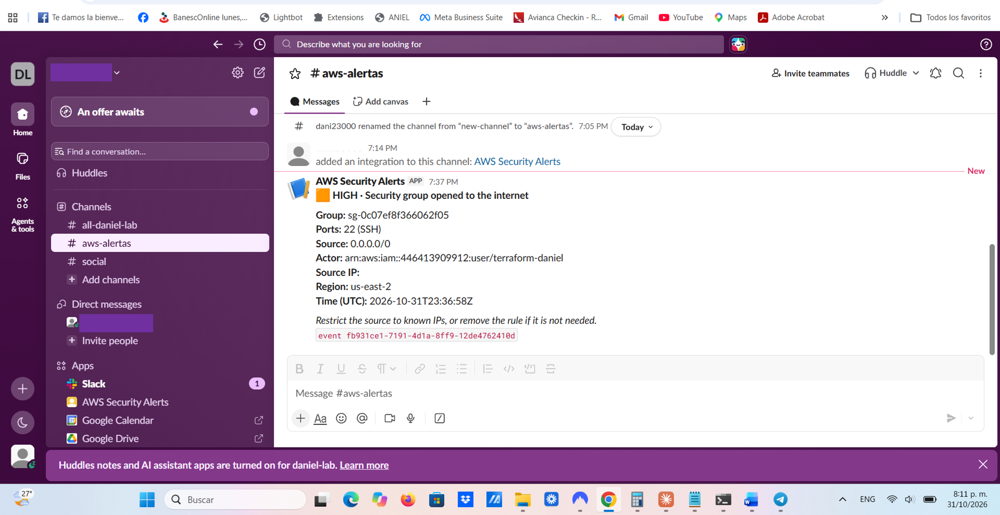
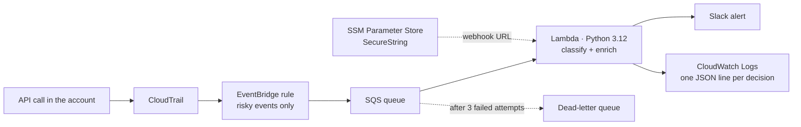

# AWS Security Alerts

Event-driven automation that detects risky security changes in an AWS account and sends a clear, enriched alert to Slack within minutes. Everything is deployed with Terraform, with least-privilege permissions and no secrets in code or state.



**Detects:**

| Change | Severity |
| --- | --- |
| Security group opened to the internet (`0.0.0.0/0` or `::/0`) on SSH, RDP, a database port or all ports | HIGH |
| Security group opened to the internet on any other port | MEDIUM |
| Root account console sign-in | HIGH |
| Access key created (root: HIGH, IAM user: MEDIUM) | HIGH / MEDIUM |
| CloudTrail logging stopped or trail deleted (audit evidence at risk) | CRITICAL |
| Any of the above attempted but denied | LOW |

Example alert (as shown in Slack):

```
🟧 HIGH · Security group opened to the internet

Group: sg-0abc1234def567890
Ports: 22 (SSH)
Source: 0.0.0.0/0
Actor: arn:aws:iam::123456789012:user/terraform-daniel
Source IP: 203.0.113.25
Region: us-east-2
Time (UTC): 2026-10-31T13:05:10Z

Restrict the source to known IPs, or remove the rule if it is not needed.
```

## Architecture



## Region note

The default region is `us-east-2` (Ohio). Accounts created with AWS's new sign-up experience are assigned one region by AWS (Ohio for the Americas) and actions in other regions are denied by an AWS-managed service control policy. In that region the security-group and CloudTrail detections work end to end. IAM and console sign-in events are global and are delivered to EventBridge only in `us-east-1`, so monitoring access keys and root sign-ins requires deploying the same rule in `us-east-1` (`-var region=us-east-1`) in an account that allows it.

## Design decisions

- **Why SQS between EventBridge and Lambda?** It decouples detection from delivery. If Slack or the Lambda fails, messages wait and are retried; after three failures they go to a dead-letter queue instead of being lost.
- **Partial batch failures.** The Lambda returns only the ids of the messages that failed (`ReportBatchItemFailures`), so one bad message never causes the others to be re-sent.
- **Secrets never touch Terraform.** The Slack webhook URL (anyone holding it can post to the channel) is stored as an SSM `SecureString` by `scripts/setup_slack.sh`. Terraform only builds its ARN to grant read access, so the value never appears in code, environment variables or the state file.
- **Least privilege.** The Lambda role can write only its own log group, consume only its queue, read only its one parameter, and decrypt only through SSM (`kms:ViaService`). The queue accepts messages only from this EventBridge rule (`aws:SourceArn`).
- **Logic is pure and tested.** `classify()` and `format_message()` have no AWS calls; the sender is injected, so the tests run without an AWS account or network.
- **Every automated action is logged** as one JSON line (`ignored`, `alerted`, `failed`) with the CloudTrail event id, for observability and audit.
- **Free tier first.** Single-region trail, CloudTrail files expire after 7 days, logs after 14 days, no NAT or VPC.

## Repository layout

```
src/alert_enricher/handler.py   Lambda: classification, message format, Slack delivery
tests/                          pytest suite and sample CloudTrail events
terraform/                      CloudTrail, S3, EventBridge, SQS + DLQ, Lambda, IAM
scripts/setup_slack.sh          stores the Slack webhook URL in SSM
scripts/trigger_test.sh         end-to-end test: opens port 22 on a throwaway group
.github/workflows/ci.yml        pytest + terraform fmt/validate on every push
```

## Deploy

Requirements: AWS CLI v2, Terraform ≥ 1.6, Python 3.12, an AWS profile (default name `aws-alertas`) and a Slack incoming webhook.

```bash
# 1. Tests
python3 -m venv .venv && . .venv/bin/activate
pip install -r requirements-dev.txt && pytest -q

# 2. Secret
./scripts/setup_slack.sh

# 3. Infrastructure
cd terraform
terraform init
terraform plan
terraform apply

# 4. End-to-end test (expect a HIGH alert in Slack within ~5 minutes)
cd .. && ./scripts/trigger_test.sh
```

## Cost

Designed to stay within the AWS free tier: the first CloudTrail trail for management events is free, and Lambda, SQS, EventBridge and CloudWatch usage here is far below the free limits. S3 storage for a week of trail files costs cents at most. Create a zero-spend budget alert before deploying.

## Tear down

```bash
cd terraform && terraform destroy
aws ssm delete-parameter --name /security-alerts/slack-webhook-url --profile aws-alertas
```

Then deactivate the deployer's access key in IAM.

## Security notes

- The deployer user has broad permissions because Terraform creates IAM roles and policies. Its keys should live only on the deploying machine (`chmod 600 ~/.aws/credentials`) and be deactivated when not in use. In a team setting this would be replaced by short-lived credentials (IAM Identity Center or GitHub OIDC).
- Terraform state is kept locally and ignored by git. A shared setup would use an S3 backend with locking.

## Next steps

- CloudWatch alarm when the dead-letter queue is not empty.
- More detections: IAM policy attached with `*:*`, public S3 bucket policy, MFA deactivated.
- Optional LLM summary of each alert, with the raw facts kept as the source of truth.
- Deploy from GitHub Actions with OIDC instead of local keys.

---

**Resumen en español:** automatización que detecta cambios de seguridad riesgosos en una cuenta de AWS (puertos abiertos a internet, ingreso con la cuenta raíz, llaves de acceso nuevas, registros de auditoría apagados) y envía una alerta clara a Slack en minutos. CloudTrail → EventBridge → SQS con cola de errores → Lambda en Python → Slack, todo desplegado con Terraform, con permisos mínimos, secretos en SSM y pruebas automáticas.
